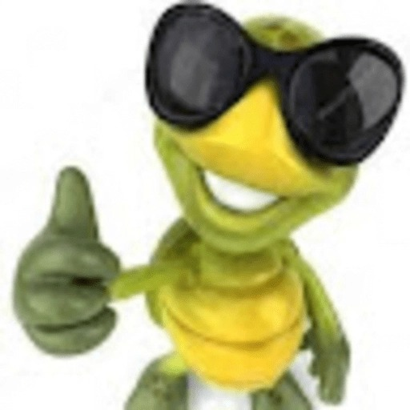
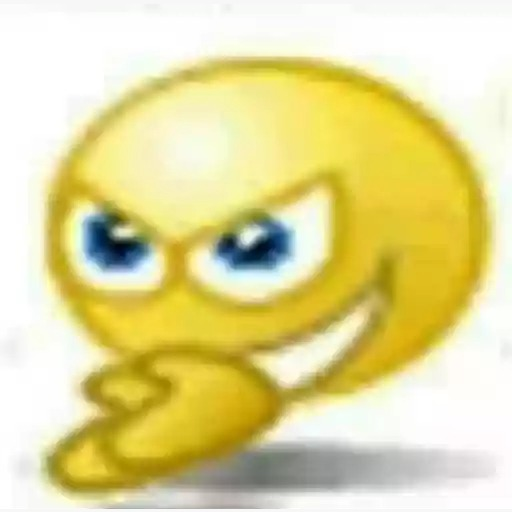
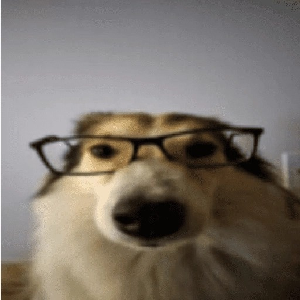
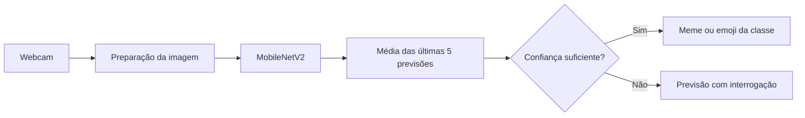

<h1 align="center">GestoMeme</h1>

<p align="center">
  <strong>Transforme seus gestos em reações, em tempo real.</strong><br>
  Reconhecimento pela webcam com visão computacional, aprendizado de máquina e memes.
</p>

<p align="center">
  <a href="#o-projeto">O projeto</a> ·
  <a href="#como-funciona">Como funciona</a> ·
  <a href="#começar">Começar</a> ·
  <a href="#personalização">Personalização</a> ·
  <a href="#tecnologias">Tecnologias</a>
</p>

---

## O projeto

O **GestoMeme** reconhece gestos e expressões capturados pela webcam e associa cada resultado a uma imagem de reação. Enquanto você interage com a câmera, o aplicativo exibe o vídeo espelhado e um painel com o meme correspondente, o nome da classe e a confiança da previsão.

O projeto reúne o ciclo de um classificador de imagens: coleta de exemplos, treinamento de uma rede neural e reconhecimento ao vivo. As classes são personalizáveis, permitindo ensinar novos gestos e escolher suas próprias reações.

| Reconhecimento ao vivo | Modelo personalizável | Reações visuais |
| :--- | :--- | :--- |
| Analisa a webcam e suaviza as previsões para reduzir mudanças bruscas. | Aprende a partir das imagens coletadas para cada gesto. | Exibe uma imagem por classe ou um emoji como alternativa. |

### Reações em cena

Algumas das imagens associadas às classes do projeto:

<table align="center">
  <tr>
    <td align="center">
      <br>
      <code>joinha</code>
    </td>
    <td align="center">
      <br>
      <code>pensativo</code>
    </td>
    <td align="center">
      <br>
      <code>oculos</code>
    </td>
  </tr>
</table>

As classes com emojis predefinidos são `caramba`, `continencia`, `desconfiado`, `joinha`, `neutro`, `oculos` e `pensativo`. As classes efetivamente reconhecidas dependem das pastas utilizadas no treinamento. A classe `neutro` representa a ausência de um gesto e, por padrão, não exibe emoji.

## Como funciona



Cada quadro é espelhado, convertido de BGR para RGB e redimensionado para **224 × 224 pixels**. O modelo calcula uma pontuação para cada classe; o aplicativo faz a média das últimas cinco previsões e seleciona a classe com maior confiança.

Quando essa confiança atinge o limiar configurado, o painel exibe a reação correspondente. Abaixo dele, o aplicativo mostra `?`, o nome da classe mais provável e a confiança, sem apresentar uma reação.

O reconhecimento acontece localmente. O modelo analisa o **quadro completo**, por isso iluminação, fundo e enquadramento também influenciam o resultado.

## Começar

Você precisa de uma **webcam**, Python compatível com as dependências e um ambiente com interface gráfica. A captura está configurada para **Windows**, usando o backend DirectShow do OpenCV.

### Instalação

Abra o PowerShell na pasta do projeto, crie um ambiente virtual e instale as dependências:

```powershell
py -m venv .venv
.\.venv\Scripts\Activate.ps1
python -m pip install -r requirements.txt
```

Se você já possui `modelo_gestos.h5` e `classes.json` na raiz do projeto, pode ir direto para [executar o aplicativo](#3-executar-o-aplicativo). Para criar seu próprio modelo, siga as etapas abaixo.

### 1. Coletar imagens

Capture exemplos de cada classe que deseja reconhecer:

```powershell
python coleta.py joinha
python coleta.py neutro --qtd 300
```

Cada comando abre a webcam para coletar uma classe. A captura começa pausada: pressione **Espaço** para iniciar ou pausar e **Q** para encerrar. As imagens são salvas em `dataset/<classe>/`.

| Opção do coletor | Padrão | Função |
| :--- | :--- | :--- |
| `classe` | Obrigatória | Nome do gesto e da pasta que receberá as imagens. |
| `--qtd` | `200` | Quantidade de novas imagens a capturar. |
| `--camera` | `0` | Índice da câmera utilizada. |

Colete pelo menos **duas classes**. O treinamento avisa quando uma classe tem menos de 50 imagens; varie a posição, a distância e a iluminação durante a coleta. Inclua exemplos sem gesto na classe `neutro` para ensinar essa situação ao modelo.

### 2. Treinar o modelo

Depois da coleta, execute:

```powershell
python train.py
```

O treinamento usa **transfer learning** com a MobileNetV2 e pesos ImageNet. Primeiro, treina a camada de classificação com a rede base congelada. Depois, ajusta as últimas camadas com uma taxa de aprendizado menor.

Ao final, o script mostra a perda e a acurácia de validação e gera dois arquivos na raiz:

| Arquivo | Conteúdo |
| :--- | :--- |
| `modelo_gestos.h5` | Rede neural treinada para reconhecer as classes coletadas. |
| `classes.json` | Mapeamento dos índices para os nomes das classes, emojis e tamanho de entrada. |

> [!NOTE]
> Na primeira execução, os pesos ImageNet podem ser baixados automaticamente. Essa etapa precisa de conexão com a internet se os pesos ainda não estiverem disponíveis no ambiente.

<details>
<summary><strong>Configuração do treinamento</strong></summary>

Os valores ficam definidos em `train.py`:

| Configuração | Valor padrão |
| :--- | :--- |
| Resolução de entrada | 224 × 224 pixels |
| Tamanho do lote | 32 imagens |
| Separação de treino e validação | 80% / 20% |
| Primeira fase | Até 15 épocas |
| Ajuste da rede base | Até 10 épocas, com as últimas 30 camadas liberadas |
| Aumento de dados | Espelhamento, rotação, zoom, translação e contraste |

O treinamento também usa parada antecipada e redução da taxa de aprendizado conforme a perda de validação. As classes recebem seus índices em ordem alfabética.

</details>

### 3. Executar o aplicativo

Com o modelo e o mapeamento de classes disponíveis, inicie o reconhecimento:

```powershell
python app.py
```

O vídeo aparece à esquerda e a reação à direita. Pressione **Q** na janela do aplicativo para sair.

Para usar outra câmera e aumentar a confiança exigida:

```powershell
python app.py --camera 1 --limiar 0.90
```

| Opção do aplicativo | Padrão | Função |
| :--- | :--- | :--- |
| `--camera` | `0` | Índice da webcam. |
| `--limiar` | `0.80` | Confiança mínima para exibir uma reação; use um valor de 0 a 1. |

## Personalização

### Adicionar um gesto

1. Colete imagens com um novo nome, por exemplo: `python coleta.py sorriso`.
2. Coloque a reação em `referencias/sorriso.jpeg`, se quiser usar uma imagem.
3. Execute `python train.py` novamente para atualizar o modelo e o mapeamento.

O nome da pasta do dataset se torna o nome da classe. A imagem de reação deve ter exatamente esse mesmo nome, com extensão `.jpeg`, `.jpg` ou `.png`.

### Trocar a reação

Substitua a imagem correspondente em `referencias/` e reinicie o aplicativo. Essa troca não exige novo treinamento, pois a imagem serve apenas para exibir o resultado.

Quando não encontra uma imagem, o app usa o emoji associado à classe no dicionário `EMOJIS` de `train.py`. Classes sem uma associação definida recebem `❓`; um emoji vazio deixa o painel sem reação. Depois de alterar o dicionário, execute o treinamento para atualizar `classes.json`.

## Tecnologias

| Tecnologia | Papel no projeto |
| :--- | :--- |
| **TensorFlow / Keras** | Construção, treinamento e execução da rede neural. |
| **MobileNetV2** | Rede base para transferência de aprendizado. |
| **OpenCV** | Captura da webcam, processamento dos quadros e interface de vídeo. |
| **NumPy** | Manipulação das imagens e suavização das previsões. |
| **Pillow** | Renderização de emojis coloridos com a fonte Noto Color Emoji. |

## Estrutura

```text
GestoMeme/
├── app.py                 # Reconhecimento ao vivo e painel de reações
├── coleta.py              # Captura das imagens de treinamento
├── train.py               # Treinamento e exportação do classificador
├── requirements.txt       # Dependências Python
├── dataset/               # Imagens organizadas em pastas por classe
├── referencias/           # Imagens de reação de cada gesto
├── fontes/                # Fonte usada para os emojis coloridos
├── modelo_gestos.h5       # Modelo gerado pelo treinamento
└── classes.json           # Mapeamento gerado pelo treinamento
```
